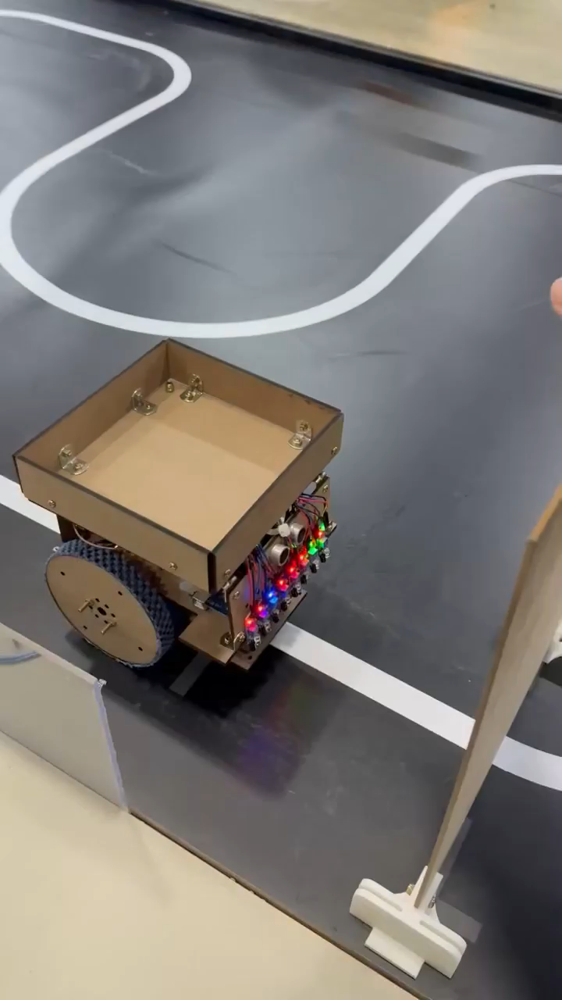
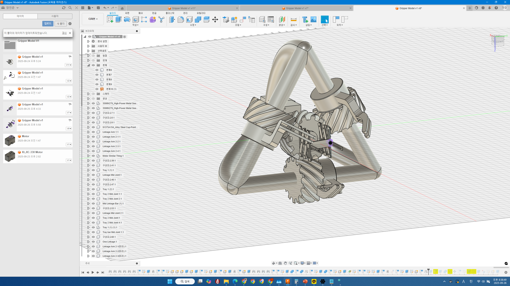

<div align="center">
  

  <h1>MechLaren</h1>
  <p><strong>A line-following car and an engineer robot for SNU Robocon 2025</strong></p>
  <p>Creative Engineering Design · Seoul National University · Team 10</p>
  <p><strong>🏆 Creative Design Award · November 21, 2025</strong></p>
  <p><a href="#the-project">Project</a> · <a href="#watch-the-iterations">Demos</a> · <a href="docs/engineering.md">Engineering</a> · <a href="firmware/README.md">Firmware</a> · <a href="hardware/README.md">CAD</a> · <a href="README.ko.md">한국어</a></p>
</div>

---

## The project

MechLaren is a pair of robots built for the Fall 2025 **Creative Engineering Design** course at Seoul National University. A car robot follows the arena's track and transports game objects. An engineer robot uses a manipulator and gripper to handle the objects. The team developed the mechanics, fabricated custom parts, tuned the control software, and revised the robots after physical trials.

The project received the **Creative Design Award** at the Department of Mechanical Engineering's 33rd-anniversary Creative Engineering Design Robocon. The [award certificate](docs/award/creative-design-award.pdf) recognizes creative ideas and engineering design and fabrication.

<table>
  <tr>
    <td align="center"></td>
    <td align="center"></td>
  </tr>
  <tr>
    <td align="center"><strong>Car robot during track testing</strong></td>
    <td align="center"><strong>Earlier gripper CAD exploration</strong><br /><sub>The final Robocon manipulator used a revised, single-arm design.</sub></td>
  </tr>
</table>

## Engineering highlights

| Area | What the team built and learned |
| --- | --- |
| Line following | Eight digital IR sensors, line-position estimation, and differential motor control with PID/PD variants |
| Signal processing | Exponential moving average filtering of the measured line position to reduce the effect of noise |
| Starting and stopping | Ultrasonic obstacle detection and a gradual speed ramp in the later control sketches |
| Manipulation | A gripper operated by spur gears, revised arm joints, and additional actuation at joints with higher torque demand |
| Fabrication | Fusion models, STEP parts, MDF cutting profiles, and repeated changes to mounts, linkages, wheels, and the chassis |
| Integration | Trade-offs between car speed, engineer-robot mobility, tire traction, arm loading, and center of gravity |

### Results in context

The design-review presentation reports a **10.6-second practice lap** during the car's earlier configuration. After the team reassigned the faster motors to the engineer robot and changed the car's gearing, the presentation reports approximately **17 seconds per lap** for the final competition configuration. These are project-reported observations from different configurations, rather than a controlled comparison or a competition ranking.

The final report records successful handling of a helmet and front wing by the engineer robot and transport by the car. Step climbing remained a limitation during the actual run. See the [engineering notes](docs/engineering.md#what-happened-in-the-final-run) for the failure analysis.

## Watch the iterations

Three original clips show successive line-tracer trials. Select a clip to open the video file on GitHub.

| [V1 · Initial trial](media/line-tracer-v1.mp4) | [V2 · Revised trial](media/line-tracer-v2.mp4) | [V3 · Later trial](media/line-tracer-v3.mp4) |
| --- | --- | --- |
| Baseline footage | Intermediate footage | Later footage referenced in the design review |

The archive does not establish an exact one-to-one mapping between each clip and a saved firmware file.

## Explore the repository

| Start here | Contents |
| --- | --- |
| [Engineering notes](docs/engineering.md) | Robot architecture, design decisions, iterations, and final-run limitations |
| [Firmware guide](firmware/README.md) | Seven preserved Arduino sketches, board assumptions, parameters, and wiring differences |
| [Hardware guide](hardware/README.md) | Selected gripper parts, chassis profiles, drivetrain models, and camera mounts |
| [Original reports](docs/reports) | Preliminary and final project reports |
| [Award certificate](docs/award/creative-design-award.pdf) | Creative Design Award, issued November 21, 2025 |
| [Source manifest](docs/source-manifest.csv) | Original relative filenames and SHA-256 hashes for the imported files |

```text
MechLaren/
├── assets/                 Team logo, robot photographs, sketches, CAD view
├── docs/                   Engineering notes, reports, award, source manifest
├── firmware/
│   ├── line-tracer/        HW2/HW3 baselines and LPF control variants
│   └── manipulator/        Modified DYNAMIXEL follower sketch
├── hardware/
│   ├── gripper/            Earlier gripper parts and revisions
│   ├── mobile-base/        MDF cutting profiles and Fusion models
│   ├── manipulator/        Drivetrain and arm-related models
│   └── mounts/             Camera trays and fixing parts
└── media/                  Original V1–V3 line-tracer videos
```

## Working with the archive

The sketches retain their original contents, with folder and sketch names aligned for opening in Arduino IDE. Begin with the [firmware guide](firmware/README.md) before choosing a version. The later LPF sketches use `Ki = 0`, so their active steering law is PD even though the archived comments use “PID.” Board wiring and sensor polarity also vary between versions.

Open the `.f3d` files in Autodesk Fusion and the `.step` files in a compatible CAD application. The hardware folders contain selected design iterations, rather than a single verified assembly release. The [hardware guide](hardware/README.md) explains the relationship between the parts.

## Team and attribution

**Team MechLaren (Team 10):** 안준표, 윤지훈, 이승현, 이준석, 장민준, as listed in the design-review presentation.

This repository is maintained by [Minjoon Jang](https://github.com/laufemj). His documented contribution includes co-designing and testing the Arduino line-following platform and gripper mechanism, and iterating printed structures, wiring, and control parameters with the team.

This repository was organized from the project's 2025 archive in November 2026. Original course handouts, workshop distributions, and vendor reference CAD are outside this selected project archive. The manipulator sketch is an adaptation of a course workshop follower example. See [attribution and reuse](RIGHTS.md) for details.
