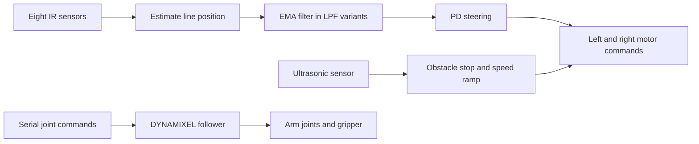
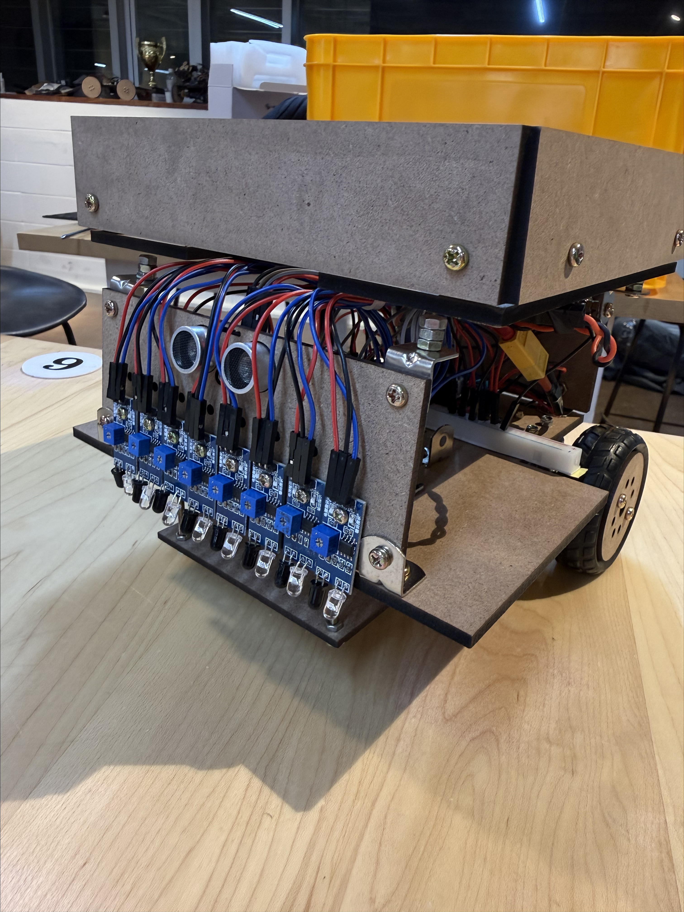
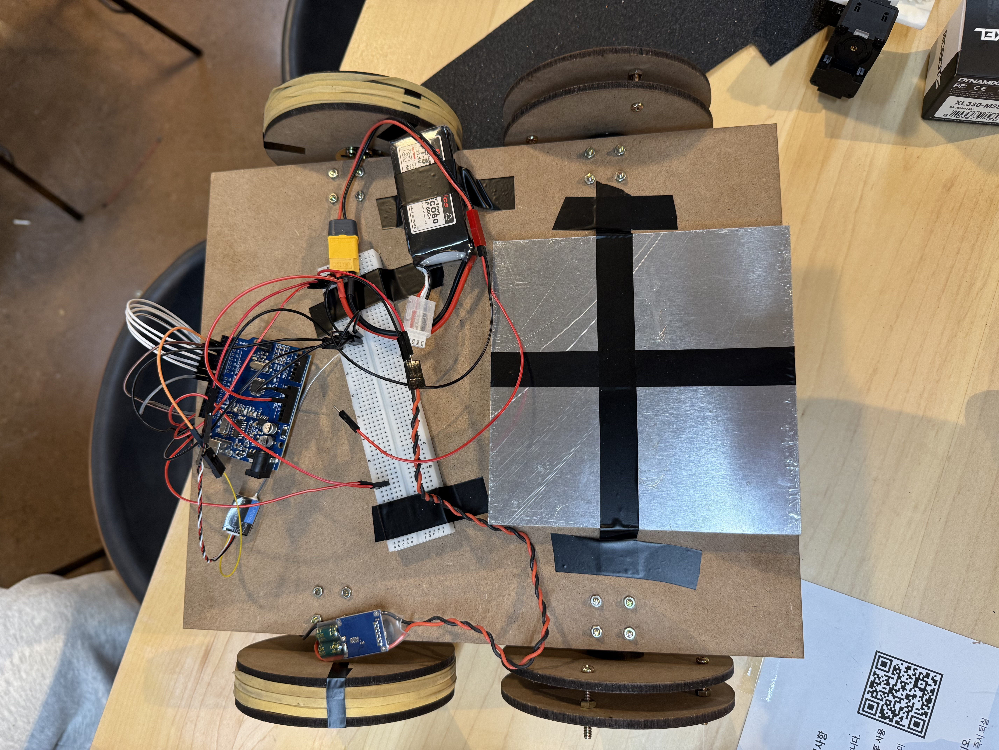
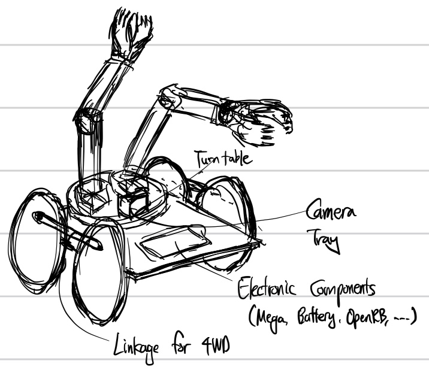

# Engineering notes

[Project overview](../README.md) · [Firmware](../firmware/README.md) · [CAD](../hardware/README.md)

## System architecture

MechLaren divided the Robocon task between two physical robots. The car followed a marked route and carried objects. The engineer robot handled the objects with a manipulator. The car's speed only helped the team when the engineer robot could prepare and transfer objects quickly enough.



The serial follower sketch captures one part of the engineer robot's actuation path. A complete matching leader/controller implementation is not present in this repository. The diagram describes the saved code and project reports; it does not imply an autonomous task planner for the engineer robot.

## Car robot

### Sensing and control

The eight digital IR sensors form a transverse array at the front of the car. When the sensors detect the line, the sketches estimate its position as the midpoint between the first and last active sensor indices. The center of the array is `3.5`.

The later variants filter that position using:

```text
filtered_position = alpha * measured_position
                  + (1 - alpha) * previous_filtered_position

error = 3.5 - filtered_position
correction = Kp * error + Ki * integral + Kd * (error - previous_error)
```

`Ki` is zero in the later sketches. The implemented steering law therefore uses proportional and difference terms. The derivative term is a per-loop difference, without division by measured elapsed time. A nominal `delay(10)` appears at the end of the loop, but sensor reads, serial output, and `pulseIn` can change the actual loop duration.

The `lpf_10s_v2` sketch increases a base-speed command gradually after a stop. It uses ultrasonic distance below 24 cm, with a positive reading, as the condition for stopping. That sketch's `alpha` of `0.977` gives most weight to the current sample, so its smoothing is relatively light. Other saved variants use different filter settings.

### Mechanical iterations

The final report describes a compact chassis with a transport tray, two driven wheels, and a ball caster. Bolts and nuts constrain the structure and reduce relative motion between electronic components. Motor-driver power and logic supply paths were separated for the intended 12 V motor and 5 V logic operation.

The design review describes increasing wheel diameter from 5 cm to 12 cm. The higher speed made start-up shocks and sensor noise more consequential, motivating changes to control gains, filtering, and acceleration. The team also changed wheel materials and component placement during physical testing.

<details>
<summary>Hardware photographs from the project archive</summary>

<p></p>
<p>Front sensor array shown in the original design review.</p>
<p></p>
<p>Early engineer-robot base before the manipulator was assembled.</p>

</details>

### Performance observations

| Observation | Configuration and evidence |
| --- | --- |
| 10.6 s practice lap | Reported on slide 6 of the original design-review presentation, before the final motor reassignment |
| About 17 s per lap | Reported on slide 7 after faster motors were moved to the engineer robot and the car received gearing changes |
| Final car motor ratio 1:171 | Described in the final report; the earlier report described 1:46.8 for the car |

The names `lpf_10s` and `lpf_12s` preserve labels from the archive. They are not independent timing measurements. The archive does not identify which exact sketch produced the 10.6 s observation or verify that a saved sketch is the final competition binary.

## Engineer robot and gripper



*Concept sketch from the final report. Earlier concepts and CAD do not all depict the final physical configuration.*

The early concept explored two arms and a turntable. The final report describes a reduction to **one gripper arm** to obtain smoother motion with available torque. It records additional motors at demanding lower joints, a redesigned second joint to reduce collisions, and changes to the gripper fingers and contact surfaces.

The report's engineer-robot configuration uses rear-wheel drive and motors with a reduction ratio of 1:46.8. The design-review slides round this ratio to 1:48. This repository uses the final report's more precise ratio when describing the final configuration.

The team considered a four-wheel-drive arrangement, but differing motor characteristics and power concerns limited its implementation. Wheel-surface trials included electrical tape, rubber bands, non-slip pads, and a silicone sushi mat. The report describes the silicone material as the most consistent trial for traction; it does not provide a measured friction coefficient.

The archived manipulator code configures six DYNAMIXEL IDs and designates one as the gripper. It uses joint position commands and signed PWM for the gripper. Code structure and physical joint count must be interpreted separately because the saved code may span design revisions and includes paired actuation.

## What happened in the final run

The final report states that the engineer robot gripped and carried a helmet and a front wing, and that the car transported them on its laps. The engineer robot struggled to climb a step during the actual run.

During practice, moving the arm changed the center of gravity enough to help the robot cross the step. The report attributes the later difficulty to the camera's added mass changing that balance and tire wear reducing traction. These are the team's failure-analysis conclusions, without a controlled experiment isolating each cause.

The team's proposed next changes were to reduce gripper and arm mass, simplify the camera shell and placement, improve tire grip, and reconsider wheel size and weight distribution. These are proposed improvements, not completed upgrades.

## Interpreting the mechanical calculations

The original reports include wheel/step torque calculations and manipulator load estimates based on assumed masses, motor torques, and geometry. Those calculations have not been rederived or checked against a final bill of materials during this archive work. They should be read as historical design reasoning, rather than certified payload, grip-force, or step-climbing specifications.

## Source record

| Source | Used for |
| --- | --- |
| [Original final report](reports/final-report.docx) | Final configuration, design alternatives, physical trials, failure analysis |
| [Original preliminary report](reports/preliminary-report.docx) | Earlier motor assignment and two-arm concept |
| [Pre-report PDF](reports/pre-report.pdf) | Intermediate design record |
| Original `Team MechLaren_Design Review.pptx`, slides 2 and 4–7 | Sensor arrangement, filtering, acceleration, practice lap, final motor reassignment |
| [Firmware files](../firmware) | Exact stored constants and implemented behavior |
| [Award certificate](award/creative-design-award.pdf) | Award name, project recipient, issuer, date |

The source presentation remains in the local course archive. Its original project images and three videos are included here, while its narrative is summarized in these notes. Every copied file is traceable through the [source manifest](source-manifest.csv).
