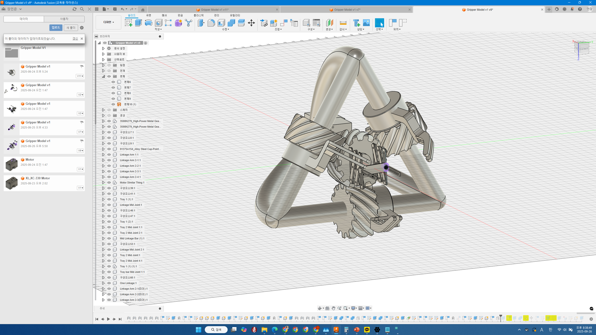
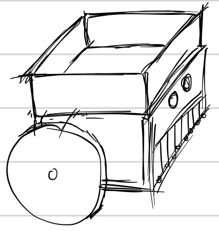
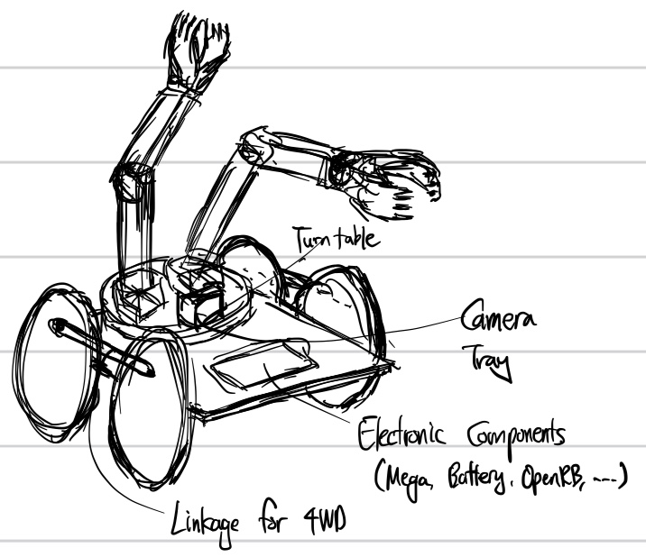

# Hardware archive

[Project overview](../README.md) · [Engineering notes](../docs/engineering.md)

These selected design files document the team's fabrication and iteration process. STEP files support inspection in compatible CAD software, Fusion `.f3d` files retain the saved native models, and DXF files capture MDF cutting profiles. The files span several revisions and do not form a verified, complete assembly release.

## Folder map

| Folder | Contents and context |
| --- | --- |
| [gripper/step](gripper/step) | Individual arm gears, gripper arms, joints, linkages, main gear, and motor tray from the folder originally labelled `Final_Things To Print` |
| [gripper/revisions](gripper/revisions) | Later modified joint and motor-tray STEP files, selected Fusion models, linkage revision, and extension tool |
| [mobile-base/dxf](mobile-base/dxf) | Chassis, wheel, tray, and roller-related MDF profiles, including multiple body revisions |
| [mobile-base/fusion](mobile-base/fusion) | Saved car-body and wheel models |
| [manipulator](manipulator) | Gear and wheel-drive variants, modified gearing, and a rack/gripper module model |
| [mounts](mounts) | Two camera-tray STEP parts, camera-tray Fusion revision, and a fixing part |

## Reading the revisions

Original basenames are retained so the [source manifest](../docs/source-manifest.csv) can connect them to the archive. “Final,” “Modified,” and version numbers reflect historical filenames. They do not guarantee that a part was used in the final competition build, or that every adjacent part is compatible.

The earlier gripper exercise explored a different mechanism from the final Robocon arm. The final report describes a single-arm robot with a spur-gear gripper and revised joints. Read the [engineering notes](../docs/engineering.md) alongside the CAD to distinguish those stages.

The source archive did not contain a reconciled bill of materials or a final assembly drawing tying all revisions together. Dimensions, fasteners, clearances, motor interfaces, and print orientation should be checked in CAD before fabrication. Machine-specific G-code and repeated sliced copies are excluded.

## Design record

*Earlier gripper design shown in the original Fusion workspace.*

<table>
  <tr>
    <td align="center"></td>
    <td align="center"></td>
  </tr>
  <tr><td align="center">Car concept</td><td align="center">Engineer-robot concept</td></tr>
</table>

The report sketches describe the concept, rather than dimensioned manufacturing drawings. Vendor reference models and the course-provided parts distribution are excluded from this selected archive. Imported references may remain inside native project files; their inclusion does not assert original authorship of standard components.
